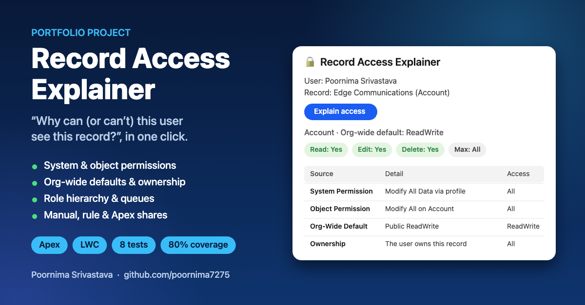

# Record Access Explainer

**"Why can (or can't) this user see this record?"** is one of the most common questions Salesforce admins and developers face. This Lightning Web Component answers it in one click.

Pick a user and a record, and the tool shows:

- the user's **effective access** (Read / Edit / Delete / max access level), as calculated by the platform
- **every layer of the sharing model** that grants that access, and where it comes from
- **warnings** that point to the likely cause when access is missing



## Why I built it

Diagnosing record access means checking many layers by hand: profiles, permission sets, org-wide defaults, ownership, the role hierarchy, sharing rules, manual shares and Apex managed sharing. This component brings all of them together in a single view, so the answer takes seconds instead of a long investigation.

## What it checks

| Layer | How it is checked |
|---|---|
| Effective access | `UserRecordAccess` (the platform's own calculation) |
| System permissions | View All Data / Modify All Data on the profile or permission sets |
| Object permissions | `ObjectPermissions` for the profile and every assigned permission set, including View All / Modify All |
| Org-wide default | `EntityDefinition.InternalSharingModel` |
| Ownership | Record owner, queue membership, and role hierarchy above the owner |
| Share records | `<Object>Share` / `<Object>__Share` rows for the user, their public groups, queues, role groups and nested groups (manual, sharing rule, Apex managed sharing, team) |

## Tech stack

- **Apex**: `RecordAccessExplainer` with dynamic SOQL, Schema describe, and wrapper classes exposed with `@AuraEnabled`
- **Lightning Web Components**: `lightning-record-picker`, `lightning-datatable`, async/await Apex calls, and error handling
- **Apex tests**: `RecordAccessExplainerTest`, with **8 tests passing at 80% code coverage**, covering ownership, role hierarchy, queues, manual sharing, admin permissions and error handling (`System.runAs`, the `Assert` class)
- **Salesforce DX** project structure, deployable with Salesforce CLI

## Deploy to your org

```bash
# 1. Log in to your Developer Edition org or sandbox
sf org login web --alias explainer-org

# 2. Deploy the source
sf project deploy start --source-dir force-app --target-org explainer-org

# 3. Run the tests
sf apex run test --class-names RecordAccessExplainerTest --result-format human --code-coverage --target-org explainer-org
```

Then open **Lightning App Builder**, add **Record Access Explainer** to an App or Home page, and activate it.

> Run the tool as a user with **View Setup and Configuration** and **View All Data** (for example a System Administrator) so that every layer can be inspected.

## Known limitations

- Implicit sharing (for example parent access through child records), territory management and external/community sharing sets are not inspected yet. When access exists but comes from one of these sources, the tool says so in a warning.
- Nested public groups are expanded up to three levels deep.

## Roadmap

- [ ] Field-level security view for the selected record
- [ ] Territory and account team support
- [ ] "Compare two users" mode

## Author

**Poornima Srivastava**: Salesforce Developer & Consultant, 6× Salesforce Certified
[LinkedIn](https://www.linkedin.com/in/poornima-srivastava-9569b0156/) · [Trailhead](https://www.salesforce.com/trailblazer/psrivastava117)
